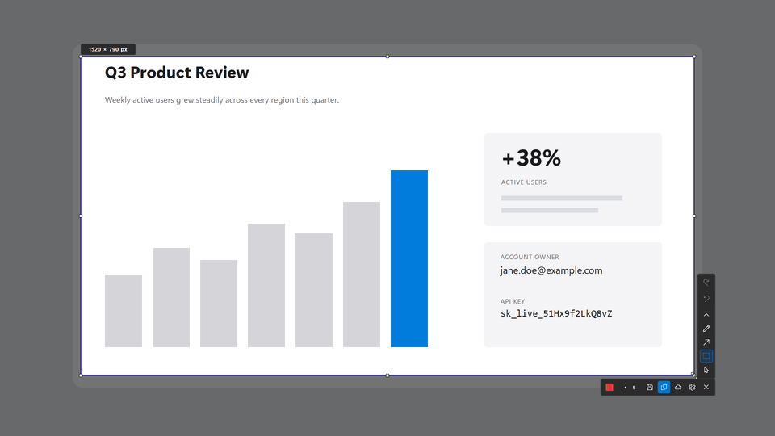
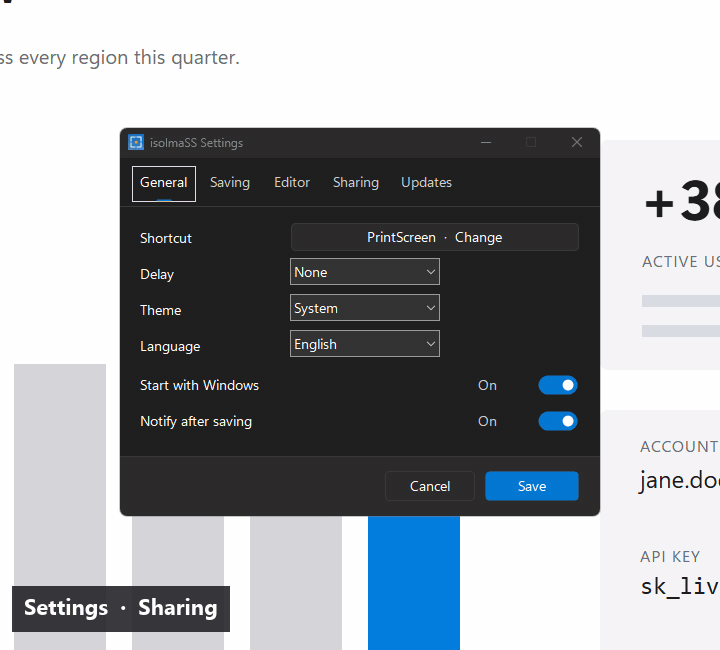
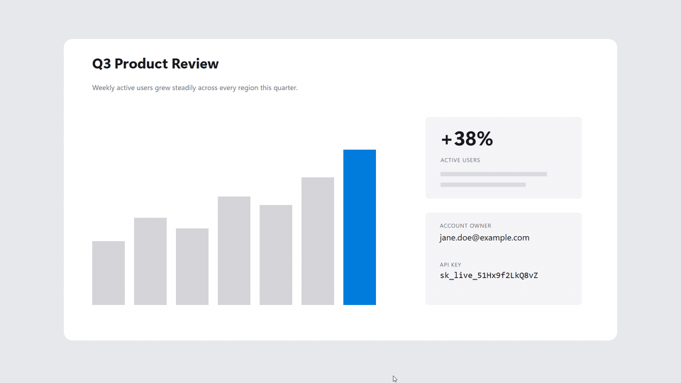
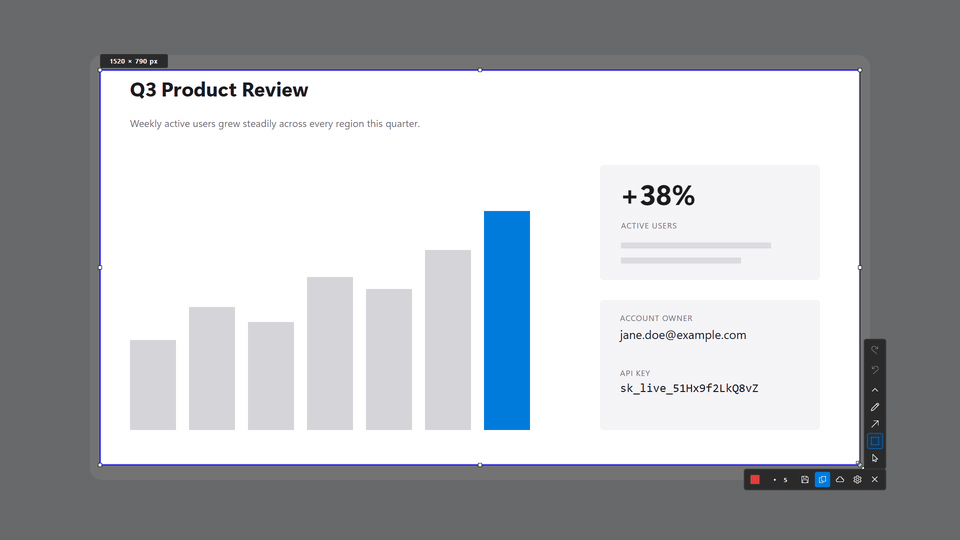
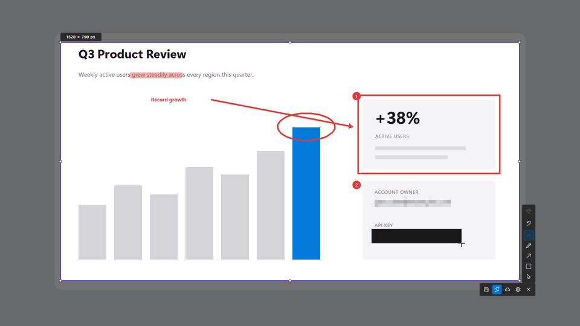
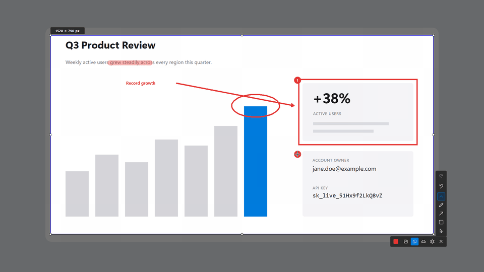

# isolmaSS

[](https://github.com/isolmaz/isolmaSS-app/actions/workflows/ci.yml)

**Screenshot, mark up, share a link — from your own Cloudflare account.**

A small, free Windows screenshot editor. Press PrintScreen, draw on the capture, press Ctrl+U, and about a second later a share link is on your clipboard. The image goes only to a private Worker in **your** Cloudflare account, never to someone else's server.

**[Download for Windows 10/11](https://github.com/isolmaz/isolmaSS-app/releases/latest/download/isolmass-setup.exe)** · [Portable ZIP](https://github.com/isolmaz/isolmaSS-app/releases/latest/download/isolmass-portable-windows-x64.zip) · [Website](https://ss.isolmaz.com) · Version **0.7.2**

## Why isolmaSS

- **Your links stay yours.** Sharing runs on a Worker the app installs in your own Cloudflare account; Cloudflare's free plan is enough. There is no isolmaSS server, account, advertising or analytics.
- **You stay in control.** Delete any link from the app, add a password, and set limits and how long images are kept.
- **Fast.** PrintScreen → drag → Ctrl+U. The link is copied before you switch windows.
- **Drawings stay editable.** Every arrow, frame, line, ellipse or text remains an object you can move, resize, recolor or delete.
- **Tiny and native.** One ~1.4 MB Windows program, light and dark themes, English and Turkish, signed updates. Open source (MIT).

## Share from your own Cloudflare

Ctrl+U uploads the capture to your Worker and copies the link. Anyone you send it to can open it in a browser. The share page has **Download**, **Open original**, **Copy link** and a **Report** button that opens Cloudflare's abuse form, plus a **Get isolmaSS** button for the recipient. A password-protected link shows the same page once it is unlocked.



The Cloudflare window shows your Worker's usage, sets your limits and lists your images. Deleting an image stops its link at once.



**Setup is a one-time wizard.** The first upload asks you to sign in to Cloudflare in your browser and approve two permissions; the app then creates the Worker for you. You don't paste keys or use a command line. Passwords for new uploads, upload and storage limits, and automatic expiry are built in. Details: [docs/CLOUDFLARE.md](docs/CLOUDFLARE.md).

When the upload card says *Uploaded · link copied*, you can also **drag the image from the card** into a chat, a browser upload field or Explorer: the drop receives the image as a file, and text fields receive the link.

## Capture

PrintScreen freezes every monitor; drag a region or click a window. **Ctrl+A** selects the whole monitor under the pointer. **Capture last region** in the tray menu reopens the editor on the region you last copied, saved or uploaded, until the app quits.



## Annotate

Ten tools, each with a one-letter shortcut: frame, ellipse, arrow, line, pen, highlighter, text, numbered steps, blur and opaque redaction. Color and line width (1–64 px) sit in the toolbar. **I** picks a color: click any pixel of the capture and its `#RRGGBB` code is copied.

Text can have several lines (**Shift+Enter** adds a line break, Enter finishes) and an optional filled background box (**Ctrl+B**), so a caption stays readable on a busy screenshot.



## Edit after drawing

Press **V**, click any drawing, then drag it, drag its handles or press Delete. Ctrl+Z brings it back. The selection box sits outside thick strokes instead of cutting through them.



## Hide sensitive details

Blur is only a visual effect. For secrets use **Redact** (M): it replaces pixels with solid ones and is applied last, so nothing shows through in the exported image.



**Ctrl+Shift+R** finds email addresses and phone numbers in the selection and covers each with a Redact box, as one undo step. Check the result: text recognition can miss what it cannot read.

## Copy text from an image

**Ctrl+Shift+C** reads the text in the selection and copies it to the clipboard. Recognition runs on your computer with Windows' built-in text recognition, so nothing is sent anywhere; Windows needs a recognition language installed. It reads the image as exported, so redactions you already drew stay hidden.

## Pin to screen

**Ctrl+T** keeps the selection on the desktop in a small always-on-top window, handy as a reference while you work in other apps. Drag it to move it, scroll to zoom (25–400 %), double-click or press Esc to close, and right-click for Copy, Save as and Close. A pin lasts until you close it or quit the app.

## Shortcuts

| Key | Action |
|---|---|
| PrintScreen | Capture (configurable, with optional delay) |
| V R E A L P T H N B M | Select, frame, ellipse, arrow, line, pen, text, highlighter, steps, blur, redact |
| I | Pick a color from the capture and copy its hex code |
| Ctrl+A | Select the whole monitor under the pointer |
| Ctrl+C / Enter | Copy |
| Ctrl+S / Ctrl+Shift+S | Save / Save as |
| Ctrl+U | Upload and copy the link |
| Ctrl+T | Pin the selection to the screen |
| Ctrl+Shift+C | Copy the text in the selection |
| Ctrl+Shift+R | Redact emails and phone numbers |
| Shift+Enter / Ctrl+B | In a text box: new line / toggle the background box |
| Ctrl+Z / Ctrl+Y | Undo / redo |
| Delete | Delete the selected drawing |
| Arrow keys | Nudge the selection or drawing (Shift: 10 px) |
| Esc or right-click | Step back or close |

All shortcuts, settings and file locations: [docs/GUIDE.md](docs/GUIDE.md). The interface follows the Windows display language (English or Turkish) and can be changed in Settings.

## Privacy

- Copy and Save never send anything. Upload goes only to the Worker in the Cloudflare account you chose.
- Text recognition (Copy text, Redact emails and phone numbers) runs locally in Windows; the image never leaves your computer for it.
- Worker keys are encrypted with Windows DPAPI; the Cloudflare sign-in token is never stored.
- Updates install only with your consent and only if the publisher signature verifies. See [SECURITY.md](SECURITY.md).

## Build and contribute

Windows x64, Visual Studio C++ Build Tools, Rust 1.98.0 and NSIS.

```powershell
powershell -ExecutionPolicy Bypass -File scripts\check.ps1   # fmt, clippy, Worker syntax
cmd /c package.bat
```

Tests are not run locally: GitHub Actions (`.github/workflows/ci.yml`) runs fmt, Clippy, the tests for the changed modules, the Worker checks and a build on every push to `main` and every pull request, and the **Release check** workflow runs the full suite with coverage before a release. Packaging, signing and releases stay local. See [CONTRIBUTING.md](CONTRIBUTING.md).

```text
src/          Rust app: capture, overlay editor, toolbar, annotations, settings, tray, updater, upload
cloudflare/   The per-user share Worker (SQLite Durable Object)
scripts/      Local checks and update signing
resources/    Icon, manifest, pinned update public key
docs/         Guide, Cloudflare reference, README media
```

[CONTRIBUTING.md](CONTRIBUTING.md) · [DISTRIBUTION.md](DISTRIBUTION.md) (releases) · [MIT License](LICENSE) · [Third-party notices](THIRD_PARTY_NOTICES.md)
